  

# Aditya Nair

**Full Stack Developer @ Kaizen Infotech** || React · TypeScript · Next.js · .NET · Node.js || Building ERPs, CRMs & Business Platforms || UI/UX Design || AI-Accelerated Engineering

I'm a Full Stack Developer building business software end to end: product design, mobile-first interfaces, APIs and data. I turn complex business operations into software teams use every day.

I work across frontend engineering, backend APIs, UI/UX design and AI-accelerated development, with a focus on shipping fast without compromising architecture or code quality.

---

### ⚡ Engineering impact

**🏢 Business platforms · Kaizen Infotech**
- ERP for a steel pipe manufacturer
- Restaurant management platform covering inventory through table bookings
- Warehouse management system
- Office management platform
- Healthcare management software
- CRM for a finance firm

**💬 [AgentBandhu](https://agentbandhu.com) · WhatsApp CRM for insurance agents**
- Automated follow-ups, reminders and customer engagement on WhatsApp

**🌐 Websites & web platforms**
- Mobile-first websites and portals for healthcare, finance and Rotary organisations

**🎨 UI/UX design**
- Product flows, design systems and high-fidelity interfaces in Figma, built into production component libraries

**🦀 Open source**
- [redis](https://github.com/MasterOogway0220/redis): a Redis-compatible data store in Rust, growing into a multi-model data layer

**🏆 Recognition**
- Best Research Paper, state-level research conference: [blockchain-based medical records sharing](https://github.com/MasterOogway0220/medichain-secure-software)

---

### 🧰 Core skills

**Frontend**

      

**Backend**

    

**Design & AI**

  

---

### 📊 GitHub activity

  
  

---

**Open to:** Full Stack Developer · Frontend Engineer · Software Engineer · UI Engineer, in Mumbai or remote

